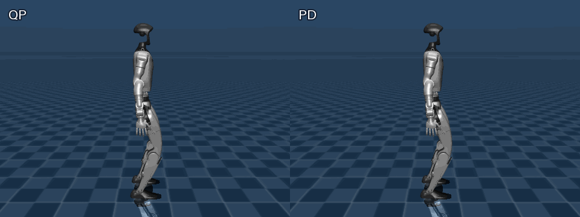
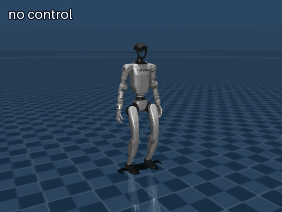
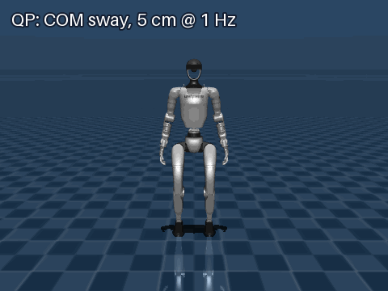
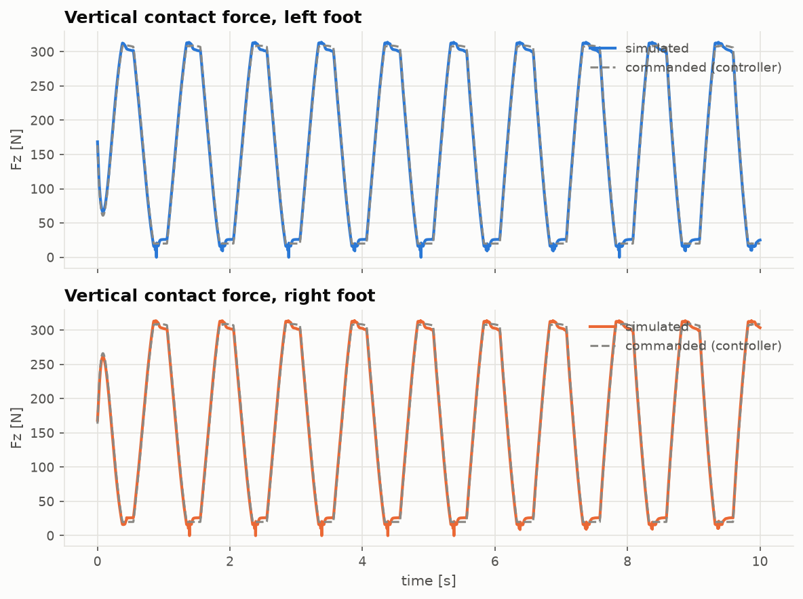
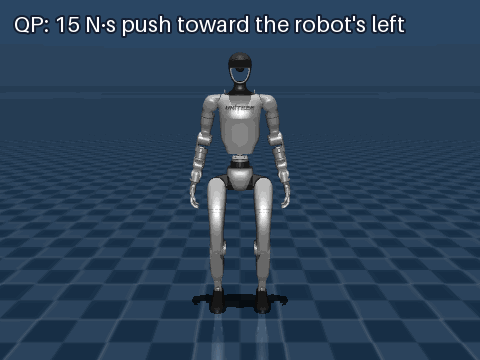
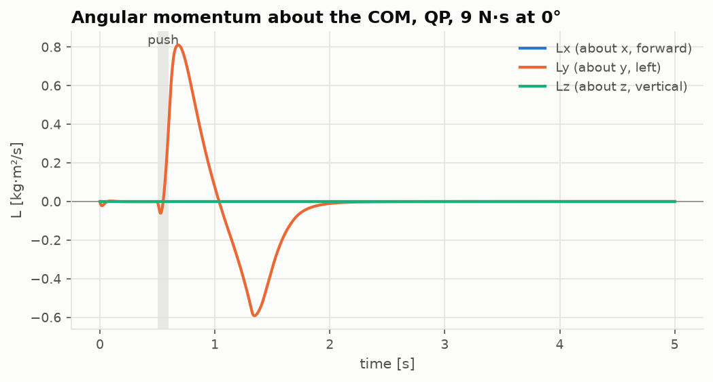
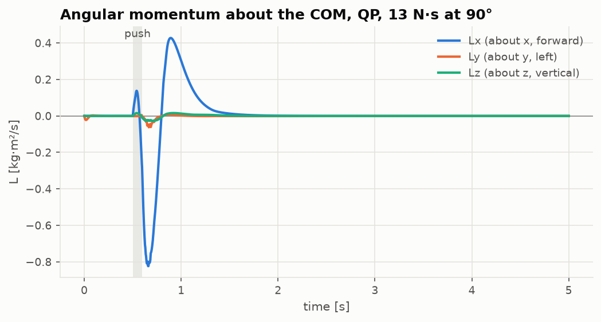
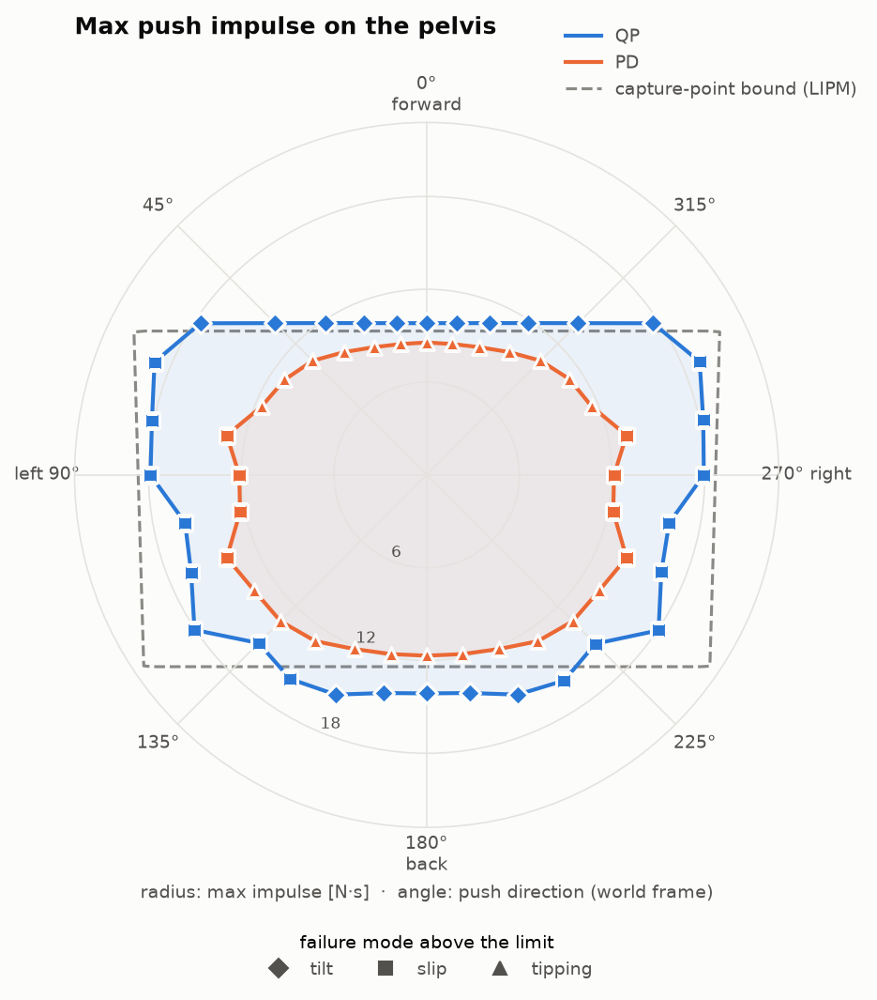

# Unitree G1 balance control in MuJoCo

Standing balance and push recovery for the Unitree G1 humanoid (29 actuated joints, 33.3 kg),
simulated in [MuJoCo](https://mujoco.org). Two torque controllers are compared: a joint-space
**PD with model-based feedforward** and a **whole-body QP** (task-space inverse dynamics with
contact, friction and torque-limit constraints, solved with [ProxQP](https://github.com/Simple-Robotics/proxsuite)).
Push robustness is measured with an impulse sweep over all horizontal directions and compared
with the capture-point bound of the linear inverted pendulum.

<p align="center">
  
  <br><em>Same 9.5 N·s forward push on the pelvis (red arrow): the QP recovers, the PD falls.</em>
</p>

## Contents
- [Controllers](#controllers)
- [Tests](#tests)
  - [No control](#1-no-control)
  - [Standing balance and COM tracking](#2-standing-balance-and-com-tracking)
  - [Single push](#3-single-push)
  - [Push sweep and capture-point bound](#4-push-sweep-and-capture-point-bound)
- [Install and run](#install-and-run)
- [Repository layout](#repository-layout)
- [Limitations](#limitations)
- [License](#license)
- [References](#references)

## Controllers

Both controllers output joint torques `tau` (29), clipped to the actuator limits before being
written to `d.ctrl`. The robot is floating-base (`nq = 36`, `nv = 35`): the first 6 velocity
coordinates are the unactuated pelvis, so torques only act on the joint rows,
`M q̈ + h = Sᵀ tau + J_cᵀ f` with `S = [0 I]`. Each foot touches the ground through 4 small
collision spheres, so the contact Jacobian `J_c` has 8 × 3 rows.

### PD with feedforward ([`controllers/PD.py`](controllers/PD.py))

```
tau = tau_ff + Kp (q_ref - q) - Kd q̇          Kd = 2 sqrt(Kp · M_jj)   (critical damping per joint)
```

| `--feedforward` | `tau_ff` |
|---|---|
| `none` | 0 (pure PD) |
| `gravity` | `h_j` — naive gravity compensation, ignores that the feet carry the weight |
| `contact` | `h_j − J_cjᵀ f` with `f = pinv(J_cbᵀ) h_b`: contact forces chosen to balance the base rows, then mapped to joint torques |

`q_ref` is the initial keyframe (`stand_bent`). Gains: 200 legs, 80 waist, 30 arms.

### Whole-body QP ([`controllers/QP.py`](controllers/QP.py))

Decision variables `x = [q̈ (35) | tau (29) | f (24)]`, solved every 1 ms step with ProxQP
(dense backend, warm-started).

| | Rows | Expression |
|---|---|---|
| **Equality** dynamics | 35 | `M q̈ + h = Sᵀ tau + J_cᵀ f` |
| **Equality** feet fixed | 12 | `J_feet q̈ + J̇_feet q̇ = −k_d v_feet` (6D per foot) |
| **Inequality** unilateral | 8 | `f_z ≥ f_min = 5 N` per sphere |
| **Inequality** friction | 32 | `|f_x|, |f_y| ≤ μ f_z`, `μ = 0.42` (linearized pyramid) |
| **Inequality** torque limits | 29 | `tau_min ≤ tau ≤ tau_max` |

Cost: `Σ w_t ‖A_t x − b_t‖²`, each task written as a desired acceleration:

| Task | `A_t` | Desired acceleration `b_t` | Weight |
|---|---|---|---|
| COM position | `[J_com 0 0]` | `Kp (c_ref − c) − Kd ċ − J̇_com q̇` | 100 |
| Pelvis orientation | `[J_ω 0 0]` | `Kp e_R − Kd ω − J̇_ω q̇` (`e_R`: rotation vector of `q_ref ⊗ q⁻¹`) | 50 |
| Posture | `[S 0 0]` | `Kp (q_ref − q) − Kd q̇_j` | 1 |
| Force regularization | `[0 0 I]` | 0 | 1e-4 |
| Torque regularization | `[0 I 0]` | 0 | 1e-5 |

All tasks use `Kp = 100`, `Kd = 20` (critically damped). The COM reference can move
(`com_offset(t)`, used for the COM tracking tests); orientation and posture references are the
initial pose.

## Tests

Simulation: MuJoCo 4.0, 1 ms timestep, `implicitfast` integrator, elliptic friction cone
(`impratio = 10`), foot friction 0.6. Initial state: keyframe `stand_bent`, COM height 0.669 m.

### 1. No control



With zero joint torques the robot collapses in about a second — the baseline every controller
has to beat.

<br clear="right">

### 2. Standing balance and COM tracking

`main_balancing.py`, 10 s per run (`results/<controller>_<option>/`), metrics over the last 2 s:

| Run | RMS leg joint error | Total vertical force / m·g | Saturated torques |
|---|---|---|---|
| PD, `none` | 1.77° | 1.000 | 0 |
| PD, `gravity` | 1.77° | 1.000 | 0 |
| PD, `contact` | **< 0.001°** | 1.000 | 0 |
| QP, static COM | 0.09° | 1.000 | 0 |
| QP, COM forward 3 cm @ 0.5 Hz | 0.57° * | 1.000 | 0 |
| QP, COM lateral 5 cm @ 1 Hz | 1.43° * | 1.000 | 0 |

- The PD only holds the keyframe precisely with the `contact` feedforward: `gravity`
  compensation alone is as bad as no feedforward, because it ignores that the ground pushes back
  on the feet.
- The QP posture error is not a tracking error: posture has the lowest weight, so it gives way to
  the COM and pelvis tasks. \* In the COM tracking runs the legs *have* to leave the keyframe
  posture to move the COM.

<p align="center">
  
  
</p>

In the lateral sway the weight moves fully from one foot to the other every half period, and
the force MuJoCo simulates follows the force the QP plans.

### 3. Single push

`main_disturbance_test.py` applies one rectangular push to the pelvis (0.1 s at t = 0.5 s,
horizontal, at the pelvis COM) and prints when each failure detector triggers.



Failure detectors ([`utils/detection.py`](utils/detection.py)):

| Detector | Threshold |
|---|---|
| fallen | pelvis drops > 15 cm |
| tilt | pelvis tilts > 30° |
| body contact | anything but the foot spheres touches the ground |
| slip | a foot moves > 2 cm or turns > 5° |
| tipping | a sole tilts > 5° |

<br clear="right">

Whole-body angular momentum about the COM (`mj_subtreeVel` → `subtree_angmom`) during QP
recoveries. The push excites rotation about the axis perpendicular to it (Ly for a forward
push, Lx for a lateral one); the QP brings it back to zero within about 1.2 s after the push:

<p align="center">
  
  
</p>

### 4. Push sweep and capture-point bound

`main_disturbance_sweep.py` finds, for 32 push directions, the largest impulse the controller
survives without any detector triggering (2.5 s observation): the impulse is doubled until the
first failure, then bisected to 0.1 N·s. Each trial starts from a fresh robot; directions run in
parallel.

The dashed line is the **capture-point bound** of the linear inverted pendulum: after an impulse
`J` the COM velocity jumps by `J / M` and the capture point `ξ = c + ċ / ω₀` by `J / (M ω₀)`.
Recovery without stepping needs `ξ` to stay inside the support polygon (convex hull of the 8
foot spheres), so

```
J_bound(θ) = M · ω₀ · d(θ),      ω₀ = sqrt(g / z_c) = 3.83 1/s
```

where `d(θ)` is the distance from the COM to the polygon edge along the push direction
([`utils/compute_base_support.py`](utils/compute_base_support.py)).

<p align="center">
  
</p>

| Direction | QP | PD | Capture-point bound |
|---|---|---|---|
| forward (0°) | 9.8 N·s (tilt) | 8.6 N·s (tipping) | 9.3 N·s |
| left (90°) | 17.9 N·s (slip) | 12.1 N·s (slip) | 18.7 N·s |
| back (180°) | 14.1 N·s (tilt) | 11.7 N·s (tipping) | 12.4 N·s |
| right (270°) | 17.9 N·s (slip) | 12.1 N·s (slip) | 18.7 N·s |

- **The QP is more robust in every direction**, by 15–65 %.
- **Forward and back, the QP exceeds the capture-point bound.** The bound assumes a point mass
  that can only move its centre of pressure; the QP also rotates the upper body (its limit there
  is the pelvis *tilt* detector, not the feet), and the 0.1 s push is not instantaneous.
- **Sideways, the QP reaches about 96 % of the bound** before the feet slip; the PD stops at
  about 65 %.
- **The PD's limit is mostly foot tipping**: its feedforward plans forces for flat feet and
  nothing keeps the centre of pressure inside the soles.

## Install and run

Python 3.12; tested with mujoco 4.0.0, proxsuite 0.8.2, numpy 2.5, scipy 1.18, matplotlib 3.11.
Writing videos needs `ffmpeg` on the system.

```bash
python -m venv .venv && source .venv/bin/activate
pip install -r requirements.txt
```

All scripts run from the project root. In the viewer, **Space** starts / pauses the simulation.
Add `--headless --duration <s>` (with `MUJOCO_GL=egl` on Linux) to run without a window.

```bash
# standing balance / COM tracking -> results/<name>/ logs.csv, plots, video.mp4
python main_balancing.py                                    # QP, static COM
python main_balancing.py --controller QP --ref lateral      # COM sway 5 cm @ 1 Hz
python main_balancing.py --controller PD --feedforward gravity

# one push, viewer with force arrow (+ angular momentum CSV/plot)
python main_disturbance_test.py --impulse 9.5 --theta 0                 # forward
python main_disturbance_test.py --controller PD --impulse 12 --theta 90 --speed 0.25

# impulse sweep + polar plot with the capture-point bound
python main_disturbance_sweep.py                            # QP and PD, 32 directions

# regenerate the GIFs in docs/media
MUJOCO_GL=egl python docs/make_media.py
```

Push direction `--theta` is in degrees in the world frame: 0 = forward (+x), 90 = robot's left (+y).

## Repository layout

```
main_balancing.py            standing balance / COM tracking runs
main_disturbance_test.py     single push, visual (viewer arrow, failure log, angular momentum)
main_disturbance_sweep.py    impulse sweep over directions -> polar plot
controllers/
  base.py                    ControlOutput (tau, planned contact forces, q_ref)
  PD.py                      joint PD + feedforward (none | gravity | contact)
  QP.py                      whole-body QP (ProxQP)
utils/
  robot.py                   G1 model: keyframe, foot spheres, Jacobians, simulated foot forces
  viewer.py                  simulation loop (viewer or headless), video recorder
  disturbance.py             push on the pelvis (xfrc_applied)
  detection.py               failure detectors
  compute_base_support.py    support polygon and capture-point bound
  logger.py                  per-step metrics and angular momentum -> CSV
  plotter.py                 time plots, polar plot, angular momentum plot
models/unitree_g1/           MJCF model (scene.xml includes g1_v2.xml), from MuJoCo Menagerie
docs/                        README media and the script that regenerates the GIFs
results/                     experiment outputs (CSV, PNG, MP4)
```

## Limitations

- **Feet are assumed flat and fixed.** The QP has no contact switching: a foot that lifts or
  tips still gets the full 6D contact constraint. Stepping is not modelled.
- **Planned vs simulated contact.** The QP keeps `f_z ≥ 5 N` on every sphere, but in the
  lateral sway the simulated force on the unloaded foot briefly drops to 0 (about 0.2 % of the
  time).
- **The QP friction coefficient (0.42) is lower than the model's (0.6)**, on purpose as a margin;
  sideways pushes still end in slip.
- **The sweep limit depends on the detector thresholds.** With the strict tipping / slip limits
  most failures happen well before an actual fall; raise them in `utils/detection.py` to measure
  the fall limit instead. Bisection assumes failure is monotonic in the impulse.
- **The capture-point bound is a model**, not a hard limit: point mass, instantaneous impulse,
  no upper-body motion.

## License

The code in this repository is released under the [MIT License](LICENSE).

The Unitree G1 model in [`models/unitree_g1/`](models/unitree_g1) comes from
[MuJoCo Menagerie](https://github.com/google-deepmind/mujoco_menagerie) and remains under
Unitree Robotics' [BSD-3-Clause license](models/unitree_g1/LICENSE).

## References

1. E. Todorov, T. Erez, Y. Tassa. *MuJoCo: A physics engine for model-based control.* IEEE/RSJ IROS, 2012.
2. K. Zakka, Y. Tassa, and MuJoCo Menagerie contributors. *MuJoCo Menagerie: A collection of high-quality simulation models for MuJoCo.* 2022. https://github.com/google-deepmind/mujoco_menagerie
3. A. Bambade, S. El-Kazdadi, A. Taylor, J. Carpentier. *PROX-QP: Yet another Quadratic Programming Solver for Robotics and beyond.* Robotics: Science and Systems (RSS), 2022.
4. S. Kajita, F. Kanehiro, K. Kaneko, K. Yokoi, H. Hirukawa. *The 3D Linear Inverted Pendulum Mode: A simple modeling for a biped walking pattern generation.* IEEE/RSJ IROS, 2001.
5. J. Pratt, J. Carff, S. Drakunov, A. Goswami. *Capture Point: A Step toward Humanoid Push Recovery.* IEEE-RAS Humanoids, 2006.
6. L. Saab, O. E. Ramos, F. Keith, N. Mansard, P. Souères, J.-Y. Fourquet. *Dynamic Whole-Body Motion Generation Under Rigid Contacts and Other Unilateral Constraints.* IEEE Transactions on Robotics, 29(2), 2013.
7. T. Koolen, S. Bertrand, G. Thomas, et al. *Design of a Momentum-Based Control Framework and Application to the Humanoid Robot Atlas.* International Journal of Humanoid Robotics, 13(1), 2016.
8. D. E. Orin, A. Goswami, S.-H. Lee. *Centroidal dynamics of a humanoid robot.* Autonomous Robots, 35(2–3), 2013.
9. J. Baumgarte. *Stabilization of constraints and integrals of motion in dynamical systems.* Computer Methods in Applied Mechanics and Engineering, 1(1), 1972.
